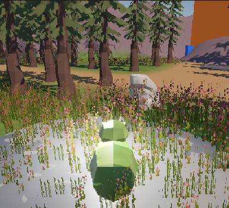
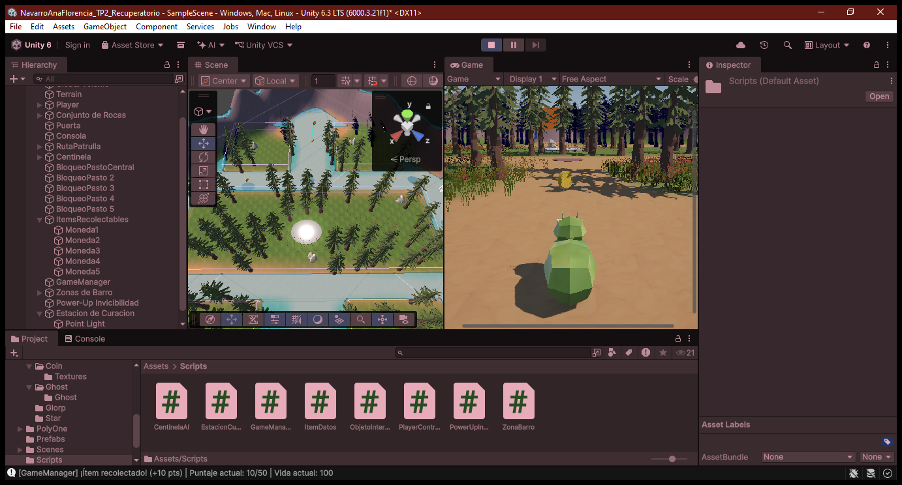

# TP2 - Recuperatorio | Proyecto de Videojuegos 1

## 🎮 Descripción del juego

Este proyecto consiste en un prototipo 3D de exploración y recolección de datos, desarrollado con **Unity 6000.3.21f1 (Unity 6.3 LTS)**. El jugador controla a Glorp y debe recorrer el escenario, reunir los ítems de datos y evitar al centinela. La meta es alcanzar **50 puntos** sin quedarse sin salud.

El nivel incluye un centinela que patrulla y persigue al jugador, una consola interactiva, zonas de barro, un power-up de invisibilidad y una Estación de Curación.

## 📸 Capturas del juego

Vista de la partida desde la cámara del jugador:



Vista de la escena y la Game View durante la ejecución. La consola muestra el puntaje y la salud:



## 🧩 Mecánicas implementadas

- **Movimiento y salto:** Glorp avanza y retrocede con el eje vertical, gira con el eje horizontal y salta con `Espacio`. Antes de saltar, un Raycast hacia abajo comprueba el suelo usando un `LayerMask`.
- **Interacción a distancia:** un Raycast frontal de hasta 4 unidades, filtrado a la capa de interactuables, permite activar la consola con `E`. La consola puede desactivar la puerta asociada.
- **Centinela e IA:** un `NavMeshAgent` recorre cuatro puntos de patrulla y persigue al jugador cuando está dentro de un radio de 10 unidades. Ataca dentro de 1,8 unidades e inflige 20 puntos de daño.
- **Salud y daño:** el jugador comienza con 100 HP. El centinela limita sus ataques a uno cada 1,5 segundos para evitar que la salud se descuente en cada frame.
- **Recolección y victoria:** cada ítem de datos recolectado suma 10 puntos. Al alcanzar los 50 puntos, el juego declara la victoria.
- **Escenario:** el nivel utiliza un Terrain texturizado, desniveles y superficies de navegación para el desplazamiento del centinela.
- **Registro de estado:** los cambios de salud, puntaje, recolección, interacción y estados de juego se informan en la consola de Unity.

## 🛠️ Correcciones y arquitectura

- Se centralizó el flujo de la partida en `GameManager`, implementado como Singleton. Administra los estados `Start`, `Playing`, `Paused`, `Victory` y `GameOver`, además de la salud y el puntaje.
- Al pausar se congela el tiempo; `P` o `Esc` reanudan la partida y `R` recarga la escena.
- Se separaron responsabilidades entre `PlayerController` (movimiento, Raycasts y habilidad de aturdimiento), `CentinelaAI` (patrulla, persecución y ataque) y `GameManager` (estado y estadísticas).
- Se agregó un intervalo entre ataques del centinela y se limitaron los usos y la recarga del arma aturdidora.
- Los Raycasts de suelo e interacción filtran las capas correspondientes para reconocer únicamente los elementos configurados para cada propósito.

## 🩹 Requisito extra: Estación de Curación

La Estación de Curación detecta a Glorp mediante un `Collider` configurado como trigger. Si el personaje está herido y permanece dentro de la zona, recupera **10 HP cada 1,5 segundos**, hasta un máximo de **30 HP por carga**. Al agotarse, la estación entra en recarga durante **10 segundos**. Durante ese período apaga la luz y cambia el material; después vuelve a activarse. Si Glorp ya tiene la salud máxima, no recibe curación.

## ✨ Requisitos opcionales

Se implementaron tres de las opciones propuestas:

1. **Opción A — Arma aturdidora por Raycast:** `F` o el clic izquierdo dispara un Raycast frontal de hasta 8 unidades. Si alcanza al centinela, lo inmoviliza durante 4 segundos. El arma tiene 3 usos y un cooldown de 6 segundos; consume una carga al acertar.
2. **Opción B — Power-Up de Invisibilidad:** al recoger el objeto, Glorp se vuelve indetectable para la IA durante **10 segundos**. Mientras dura el efecto, el centinela interrumpe la persecución y retoma la patrulla.
3. **Opción D — Zona de Desaceleración / Barro:** al entrar en una zona trigger, la velocidad de Glorp baja de 6 a 2,5. Al salir, se restaura la velocidad original.

## 🕹️ Controles

| Acción | Teclado |
| --- | --- |
| Avanzar / retroceder | `W` / `S` o flechas `↑` / `↓` |
| Girar | `A` / `D` o flechas `←` / `→` |
| Saltar | `Espacio` |
| Interactuar con la consola | `E` |
| Disparar el arma aturdidora | `F` o clic izquierdo |
| Pausar / reanudar | `P` o `Esc` |
| Reiniciar la escena | `R` |

## 🚀 Requisitos

- Unity Hub.
- Unity **6000.3.21f1 (Unity 6.3 LTS)**.
- Módulo **AI Navigation** para la navegación con `NavMeshAgent`.
- Módulo **Universal Render Pipeline (URP)** utilizado por el proyecto.

## 📦 Instrucciones para abrir y ejecutar el proyecto

1. Abre Unity Hub y selecciona **Open**.
2. Selecciona la carpeta raíz del proyecto.
3. Abre el proyecto con Unity **6000.3.21f1** y espera a que se importen los recursos.
4. Abre `Assets/Scenes/SampleScene.unity`.
5. Pulsa **Play** en la barra superior para ejecutar el juego.

## 🗂️ Estructura principal del proyecto

```text
Assets/
├── Scenes/
│   ├── SampleScene.unity
│   └── SampleScene/
│       └── NavMesh-Terrain.asset
└── Scripts/
    ├── CentinelaAI.cs
    ├── EstacionCuracion.cs
    ├── GameManager.cs
    ├── ItemDatos.cs
    ├── ObjetoInteractivo.cs
    ├── PlayerController.cs
    ├── PowerUpInvisibilidad.cs
    └── ZonaBarro.cs

Documentacion/
└── Capturas/
    ├── gameplay-01.png
    └── gameplay-02.png
```

## 🛠️ Tecnologías utilizadas

- Unity 6000.3.21f1 (Unity 6.3 LTS)
- C#
- Unity Physics (`Rigidbody`, `Collider`, Raycast y `LayerMask`)
- AI Navigation (`NavMeshSurface` y `NavMeshAgent`)
- Universal Render Pipeline (URP)

## 🌿 Versionado del proyecto

El proyecto se versiona con Git y cuenta con un repositorio remoto en GitHub. El archivo `.gitignore` excluye carpetas y archivos generados por Unity, como `Library/`, `Temp/`, `Logs/`, `Obj/` y `Build/`, para evitar incluir cachés y resultados de compilación en el control de versiones.

## 👩‍💻 Autor

**Ana Florencia Navarro**  
Programación de Videojuegos I
